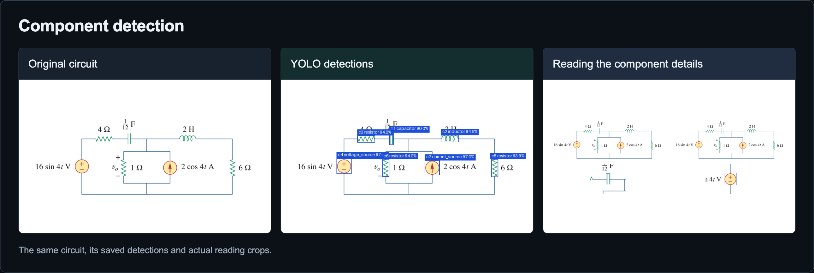
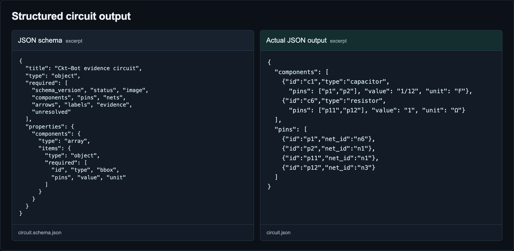
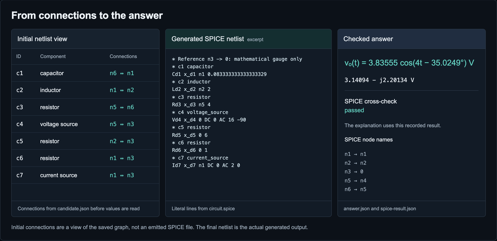

**DO NOT DISTRIBUTE: INTELLECTUAL PROPERTY OF HKU ECE**

**COPYRIGHT 2026. ALL RIGHTS RESERVED IN PROJECT-OWNED MATERIAL BY ITS LAWFUL RIGHTS HOLDERS.**

**CONFIDENTIAL MATERIAL. AUTHORIZED INTERNAL RESEARCH AND REVIEW ONLY. NO PUBLIC LICENSE IS GRANTED TO USE, COPY, MODIFY, DISCLOSE, DISTRIBUTE, PUBLISH, SUBLICENSE OR COMMERCIALIZE PROJECT-OWNED MATERIAL. PRIOR WRITTEN PERMISSION FROM THE RELEVANT RIGHTS HOLDER IS REQUIRED.**

**I WILL PURSUE LEGAL ACTION, INCLUDING A CIVIL LAWSUIT, AGAINST UNAUTHORIZED USE OR DISTRIBUTION OF PROJECT-OWNED MATERIAL WHERE I AM LEGALLY ENTITLED TO ENFORCE THOSE RIGHTS. AVAILABLE REMEDIES MAY INCLUDE AN INJUNCTION, DAMAGES AND LEGAL COSTS.**

**THE HKU ECE ATTRIBUTION IS THE PROJECT OWNER'S DESIGNATED NOTICE. OWNERSHIP AND AUTHORITY REMAIN SUBJECT TO APPLICABLE LAW, HKU INTELLECTUAL PROPERTY POLICY AND RELEVANT AGREEMENTS. THIS NOTICE DOES NOT EXECUTE AN ASSIGNMENT OF RIGHTS.**

**THIRD-PARTY COMPONENTS, LICENSES AND NOTICES REMAIN SUBJECT TO THEIR ORIGINAL TERMS. THIS NOTICE DOES NOT CLAIM OWNERSHIP OF THOSE COMPONENTS OR RESTRICT RIGHTS GRANTED UNDER THEIR LICENSES. STATUTORY EXCEPTIONS AND NON-WAIVABLE RIGHTS REMAIN UNAFFECTED.**

**[FULL LICENSE](LICENSE) · [HONG KONG COPYRIGHT ORDINANCE, CAP. 528](https://www.elegislation.gov.hk/hk/cap528) · [COPYRIGHT GUIDANCE](https://www.ipd.gov.hk/en/copyright/what-is-copyright/index.html) · [HKU INTELLECTUAL PROPERTY POLICY](https://www.rss.hku.hk/contracts/ipr)**

---

<h1 align="center">K-Bot</h1>

Upload a circuit. Ask a question. See the working.

<a href="run.md">Setup guide</a> · <a href="#pipeline">Pipeline</a> · <a href="https://huggingface.co/Meghamsh111/KBOT-models">Models</a>

K-Bot reads circuit diagrams and produces worked answers. The web interface shows each stage, from finding components and tracing wires to calculating and explaining the result.

## Architecture

## How it works

The panels use actual outputs from the completed Sadiku Figure 10.52 run, a known example.

### Find the components

**YOLO26n** identifies components and marks their positions with bounding boxes.

### Trace wires and connect components

**SAM2.1** supplies the line mask. The **graph assembler** traces connections between component terminals.

### Read, calculate and explain

The **vision-language model** reads values and labels. The question model selects what to calculate. **SymPy** calculates the answer, **ngspice** checks it, and the explanation model presents the working.

The panels are rendered from [HTML and CSS](docs/visuals/index.html), using the saved run data. Their source and rendering script are included in the same folder.

## Run K-Bot

Follow **[run.md](run.md)** to install the software, download the models, sign in and start the web interface. Each teammate needs their own hosted-model login and access.

The models are stored on [Hugging Face](https://huggingface.co/Meghamsh111/KBOT-models). See [run.md](run.md#what-is-included) for files kept outside GitHub. Docker remains experimental and unverified.

## Current status

A fresh environment on the original Mac completed one known AC circuit through the browser in **55.8 seconds**. The answer matched an independent calculation. See the [reproduction record](provenance/HANDOFF_REPRODUCTION_20261119.json).

Faint wires, crossings and misread labels can still produce the wrong circuit. One successful example does not establish accuracy on new circuits. A second physical machine has not been tested.
