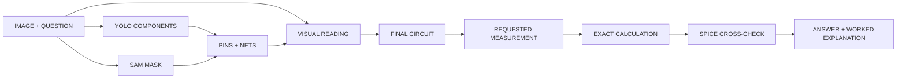
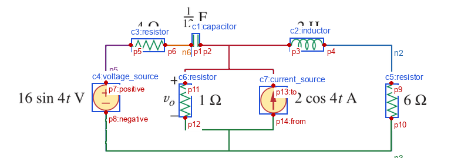

# DO NOT DISTRIBUTE — INTELLECTUAL PROPERTY OF HKU ECE

<h1 align="center">⚡ KBOT</h1>

READ THE CIRCUIT. INSPECT THE CONNECTIONS. CHECK THE ANSWER.

<a href="run.md">🚀 RUN THE DEMO</a> · <a href="#the-workflow">🧭 THE WORKFLOW</a> · <a href="#from-the-question-to-the-answer">🧮 ANSWERS</a> · <a href="EXCLUSIONS.md">📦 MODEL FILES</a> · <a href="LICENSE">🔒 RESTRICTIONS</a>

**CONFIDENTIAL · AUTHORIZED INTERNAL RESEARCH USE ONLY · PRIVATE SOURCE FREEZE**

KBOT TAKES A CIRCUIT IMAGE AND A QUESTION, RECOVERS COMPONENTS AND CONNECTIONS, AND CALCULATES THE REQUESTED ELECTRICAL QUANTITY. THE WEB INTERFACE EXPOSES THE DETECTIONS, SEGMENTATION, GRAPH, READINGS AND WORKED ANSWER SO EACH STAGE CAN BE INSPECTED.

## 🧭 THE WORKFLOW

### 🔍 1. FIND THE COMPONENTS

YOLO26N LOCATES THE SYMBOLS AND ASSIGNS COMPONENT CLASSES. BOXES IDENTIFY WHAT IS PRESENT AND WHERE; THE CONNECTIONS ARE RECOVERED SEPARATELY.

### 🧵 2. TRACE THE WIRES

THE GRAPH BUILDER PROCESSES THE SEGMENTED CIRCUIT STROKES AND EXCLUDES COMPONENT BODIES TO ISOLATE THE WIRING. THIS SAVED WIRE MASK IS THE INPUT TO CONNECTION TRACING:

<em>WHITE PIXELS SHOW THE RETAINED WIRE STROKES. BLACK PIXELS ARE BACKGROUND OR EXCLUDED REGIONS.</em>

THE ASSEMBLER FOLLOWS CONNECTED WIRE SEGMENTS AND ASSOCIATES COMPONENT TERMINALS WITH THEM. TERMINALS THAT SHARE A CONNECTED WIRE NETWORK RECEIVE THE SAME NET ID.

**WIRE SEGMENTS → COMPONENT TERMINALS → CONNECTED NETS → CIRCUIT GRAPH**

GAPS WHERE COMPONENT BODIES WERE REMOVED ARE EXPECTED: THE COMPONENT CONNECTS ITS TERMINALS THROUGH ITS ELECTRICAL MODEL. UNINTENDED GAPS AND AMBIGUOUS CROSSINGS STILL NEED CHECKING. THE MASK ABOVE IS AN UNMODIFIED OUTPUT FROM THE SAME SAVED RUN AS THE DETECTIONS AND GRAPH.

### 🔗 3. BUILD THE ELECTRICAL CONNECTIONS

THE PYTHON GRAPH ASSEMBLER ASSOCIATES COMPONENT TERMINALS WITH NETS. A NET IS A CONNECTED WIRE NETWORK; EACH NET REPRESENTS AN ELECTRICAL NODE UNDER THE IDEAL-WIRE ASSUMPTION. LABELS SUCH AS `n1` AND `n2` ARE IDENTIFIERS, NOT VALUES OR AUTOMATIC GROUND DESIGNATIONS.

THE GRAPH RECORDS WHICH TERMINALS SHARE A NET. PARALLEL BRANCHES SHARE THE SAME TWO NETS. A SERIES RELATIONSHIP REQUIRES CHECKING OTHER CONNECTIONS AT THE SHARED NODE. GROUNDS, SOURCE DIRECTIONS AND OP-AMP PIN ROLES ALSO AFFECT THE ELECTRICAL MODEL.

### 👁️ 4. READ VALUES, UNITS AND REFERENCES

THE VISION-LANGUAGE STAGE INTERPRETS COMPONENT VALUES, UNITS, POLARITY, PHYSICAL PIN ROLES AND PRINTED MEASUREMENT REFERENCES USING THE ORIGINAL IMAGE AND COMPONENT CONTEXT. A CORRECTLY READ NUMBER MUST ALSO BELONG TO THE CORRECT COMPONENT.

READINGS AND CONNECTIONS ARE STORED AS STRUCTURED RECORDS. INVALID OR INCOMPLETE EVIDENCE CAN STOP THE RUN; VALID JSON BY ITSELF DOES NOT PROVE A CORRECT CIRCUIT.

## 🧮 FROM THE QUESTION TO THE ANSWER

THE QUESTION SELECTS A PHYSICAL MEASUREMENT, NOT JUST A TEXT LABEL. A REQUEST SUCH AS “FIND THE INDUCTOR CURRENT” NEEDS A SPECIFIC BRANCH AND POSITIVE DIRECTION. A VOLTAGE REQUEST NEEDS ITS POSITIVE AND NEGATIVE TERMINALS. THESE TARGETS MUST BE BOUND TO THE EXTRACTED GRAPH BEFORE CALCULATION.

FOR THE SAVED EXAMPLE BELOW, THE PRINTED OUTPUT REFERENCE IS BOUND AS FOLLOWS:

| REQUEST | POSITIVE NET | NEGATIVE NET | CALCULATED QUANTITY |
| --- | --- | --- | --- |
| $V_o$ | `n1` | `n3` | $V(n1)-V(n3)$ |

THIS BINDING IS TAKEN FROM THE ACTUAL SAVED CIRCUIT RECORD. AN INDUCTOR-CURRENT REQUEST SIMILARLY NEEDS THE INDUCTOR'S BRANCH AND SIGNED DIRECTION; A COMPONENT CLASS ALONE DOES NOT IDENTIFY THE REQUESTED CURRENT.

SYMPY BUILDS AND SOLVES THE LINEAR EQUATIONS. NGSPICE ANALYSES THE EXTRACTED NETLIST AS A NUMERICAL CROSS-CHECK. THE EXPLANATION STAGE USES THE RECORDED CALCULATION TO PRESENT THE WORKED SOLUTION.

### 🌊 A SAVED AC EXAMPLE

**QUESTION:** FIND THE MARKED OUTPUT VOLTAGE IN SINUSOIDAL STEADY STATE.

AT $\omega=4\ \mathrm{rad/s}$, THE CAPACITOR HAS $Z_C=-j3\ \Omega$ AND THE INDUCTOR HAS $Z_L=j8\ \Omega$. THE VOLTAGE SOURCE IS $-j16\ \mathrm{V}$ USING A PEAK COSINE REFERENCE. KCL AT THE OUTPUT NODE GIVES:

$$\frac{V_o+j16}{4-j3}+\frac{V_o}{1}+\frac{V_o}{6+j8}=2.$$

THE SAVED RUN RETURNS:

$$V_o=3.14094-j2.20134=3.83555\angle-35.0249^\circ\ \mathrm{V}.$$

$$v_o(t)=3.83555\cos(4t-35.0249^\circ)\ \mathrm{V}.$$

THE RESULT MATCHES THE SEPARATE NODAL CALCULATION AND PASSED THE SPICE CROSS-CHECK. THE IMAGES ABOVE ARE SAVED KBOT OUTPUTS FOR SADIKU FIGURE 10.52, NOT A LIVE RUN OR AN UNSEEN BENCHMARK. [IMAGE PROVENANCE](docs/images/PROVENANCE.json).

### ➡️ READING AN INDUCTOR CURRENT FROM THE GRAPH

IN THE SAME SAVED CIRCUIT, THE $2\,\mathrm{H}$ INDUCTOR IS COMPONENT `c2`: ITS LEFT TERMINAL `p3` IS ON `n1` AND ITS RIGHT TERMINAL `p4` IS ON `n2`. DEFINING $I_L$ FROM LEFT TO RIGHT GIVES:

$$I_L=\frac{V(n1)-V(n2)}{j8}=\frac{V_o}{6+j8}=\frac{46-j1428}{3725}\ \mathrm{A}.$$

THIS VALUE IS ALREADY PRESENT IN THE SAVED LINEAR STATE AS THE INDUCTOR TERMINAL CURRENT. IT ALSO MATCHES THE SEPARATE BRANCH-CURRENT CALCULATION. THIS ILLUSTRATES HOW CONNECTIONS AND DIRECTION DEFINE A CURRENT; IT IS NOT A SEPARATE NEW IMAGE-TO-ANSWER TEST.

## 🖥️ THE WEB INTERFACE

- UPLOAD A CIRCUIT IMAGE AND ENTER ITS QUESTION.
- FOLLOW DETECTIONS, THE SAM MASK, PINS AND NETS, AND THE FINAL GRAPH AS THE RUN PROGRESSES.
- INSPECT THE READINGS, CALCULATED QUANTITIES AND LATEX-RENDERED WORKED SOLUTION.
- REOPEN PREVIOUS RUNS FOR DIAGNOSIS; IDENTIFY SAVED OUTPUTS AS BACKUPS DURING A DEMONSTRATION.

THE NUMERICAL ANSWER AND EXPLANATION HAVE SEPARATE STATUS. A CHECKED ANSWER CAN BE DISPLAYED WHILE THE EXPLANATION FINISHES. RUN ARTIFACTS ARE SAVED LOCALLY AND ARE NOT CHECKED INTO SOURCE CONTROL.

## 🛠️ TECHNOLOGY

| PART | CURRENT ROLE |
| --- | --- |
| YOLO26N | LOCAL COMPONENT DETECTION |
| SAM2.1 | LOCAL FOREGROUND SEGMENTATION |
| PYTHON GRAPH ASSEMBLER | TERMINALS, NETS AND MEASUREMENT REFERENCES |
| HOSTED VISION/LANGUAGE BACKEND | CONTEXTUAL READING, QUESTION INTERPRETATION AND EXPLANATION |
| SYMPY | EXACT LINEAR CALCULATION |
| NGSPICE | NUMERICAL CROSS-CHECK |
| PYTHON + HTML/CSS/JAVASCRIPT + KATEX | LOCAL WEB INTERFACE |

## 🚀 SETUP AND USAGE

START WITH THE [STEP-BY-STEP RUN GUIDE](run.md). IT EXPLAINS WHAT TO INSTALL, WHICH PRIVATE MODEL FILES TO OBTAIN, HOW TO CONFIGURE THE ENVIRONMENT AND HOW TO OPEN THE DEMO.

**A CLONE ALONE IS NOT ENOUGH.** WEIGHTS AND AUTHENTICATION ARE PROVIDED SEPARATELY. THE ORIGINAL MAC CONFIGURATION AND THE OPTIONAL DOCKER ROUTE HAVE DIFFERENT ENVIRONMENT REQUIREMENTS; SEE THE GUIDE FOR WHAT HAS ACTUALLY BEEN CHECKED.

THE DEFAULT LOCAL ADDRESS IS `http://127.0.0.1:8766/`.

## 🧪 RESEARCH STATUS

THIS IS A FROZEN RESEARCH DEMONSTRATION, WITH SOURCE SNAPSHOT TAG `FREEZE-2026-11-19`. THE TAG PRESERVES THE ORIGINAL FREEZE; DOCUMENTATION AND REPRODUCTION HELPERS CAN ADVANCE ON THE MAIN BRANCH.

SUPPORTED CALCULATION SCOPE IS LINEAR DC AND AC STEADY STATE, INCLUDING DEPENDENT SOURCES AND EXPLICITLY IDEAL LINEAR OP-AMPS. THIS DOES NOT ESTABLISH BROAD IMAGE-READING COVERAGE OR NONLINEAR/TRANSIENT SUPPORT.

WIRE DISCONTINUITIES, CROSSINGS, EXTRA TERMINALS, WRONG VALUE OWNERSHIP AND AMBIGUOUS REFERENCE DIRECTIONS REMAIN IMPORTANT FAILURE MODES. SOLVER AGREEMENT CHECKS THE EXTRACTED CIRCUIT; IT DOES NOT PROVE THAT CIRCUIT MATCHES THE IMAGE. NO OVERALL ACCURACY IS CLAIMED FROM PREPARED EXAMPLES.

## 📦 FILES AND MODEL ACCESS

THE SOURCE INCLUDES THE PIPELINE, GRAPH ASSEMBLER, WEB UI, LAUNCH SCRIPTS, CONFIGURATION AND CHECKSUM RECORDS. [EXCLUSIONS.md](EXCLUSIONS.md) LISTS THE WEIGHT IDENTITIES AND EXTERNAL DEPENDENCIES.

YOLO WEIGHTS, SAM BASE/FINE-TUNED WEIGHTS, TRAINING DATA, PRIVATE ANSWERS, SEALED TESTS, USER RUNS, LOCAL ENVIRONMENTS AND CREDENTIALS REMAIN OUTSIDE NORMAL GIT HISTORY. ONLY THE EXPLICITLY SELECTED DOCUMENTATION IMAGES ARE INCLUDED HERE.

## 🔒 COPYRIGHT AND ACCESS

DO NOT DISTRIBUTE, PUBLISH OR SUBLICENSE PROJECT-OWNED MATERIAL WITHOUT WRITTEN AUTHORIZATION FROM THE RELEVANT RIGHTS HOLDER. NO PUBLIC OR OPEN-SOURCE LICENSE IS GRANTED FOR PROJECT-OWNED MATERIAL. SEE [LICENSE](LICENSE).

THE HKU ECE ATTRIBUTION IS THE PROJECT OWNER'S DESIGNATED NOTICE. ACTUAL OWNERSHIP IS GOVERNED BY APPLICABLE LAW, HKU POLICY AND RELEVANT AGREEMENTS. THIRD-PARTY COMPONENTS AND EXAMPLE DIAGRAMS RETAIN THEIR OWN RIGHTS; THEIR NOTICES AND LICENCE TERMS ARE NOT OVERRIDDEN.

- [HONG KONG COPYRIGHT ORDINANCE, CAP. 528](https://www.elegislation.gov.hk/hk/cap528)
- [INTELLECTUAL PROPERTY DEPARTMENT — COPYRIGHT AND OWNERSHIP](https://www.ipd.gov.hk/en/copyright/what-is-copyright/index.html)
- [HKU INTELLECTUAL PROPERTY RIGHTS POLICY](https://www.rss.hku.hk/contracts/ipr)

THIS README USES CAPITAL LETTERS AS REQUESTED. SETUP GUIDES USE NORMAL SENTENCE CASE. COMMANDS, PATHS, IDENTIFIERS, URL TARGETS AND ORIGINAL THIRD-PARTY NOTICES RETAIN THEIR REQUIRED CASE.
