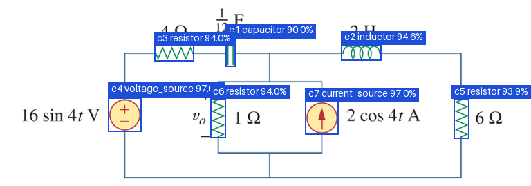

> **DO NOT DISTRIBUTE — INTELLECTUAL PROPERTY OF HKU ECE**

<h1 align="center">⚡ K-Bot</h1>

Circuit diagrams to connections, equations and worked answers.

<a href="run.md">Get started</a> · <a href="#pipeline">Explore the pipeline</a> · <a href="#example">Worked example</a> · <a href="EXCLUSIONS.md">Model files</a>

K-Bot turns a circuit image and a question into an inspectable circuit representation and a worked answer. The web interface shows component detections, wire traces, connections, readings and calculations as the analysis progresses.

## 🔎 A circuit, step by step

These are actual outputs from a saved development run on **Sadiku Figure 10.52**, a known worked example.

<table>
<tr><th width="50%">Circuit image</th><th width="50%">Component detections</th></tr>
<tr><td></td><td></td></tr>
</table>

### ① Find the components

**YOLO26n** locates resistors, sources, capacitors, inductors and other supported symbols. The boxes identify component types and positions; the wiring determines how those components interact.

### ② Trace the wires

**SAM2.1 and graph preprocessing** provide the wire evidence. Component bodies are excluded from the segmented strokes, leaving the processed wire mask used for connection tracing.

White pixels are retained wire strokes. Gaps at removed component bodies are expected.

The assembler follows these segments and associates component terminals with them. It still needs to distinguish genuine junctions, unconnected crossings and unintended gaps.

### ③ Turn the wiring into a circuit graph

The **Python graph assembler** records components, their terminals and their connected nets. A net is one connected wire network, treated as an electrical node. Labels such as `n1` identify nets; they do not automatically designate ground.

This representation determines the equations. Parallel components share the same two nets. A requested current needs a branch and direction; a requested voltage needs positive and negative terminals.

### ④ Read, calculate and explain

- **The hosted vision-language model** reads values, units, polarity and pin roles in context and associates them with components.
- **Question interpretation** binds the requested measurement to the graph.
- **SymPy** solves the linear circuit equations.
- **ngspice** provides a numerical cross-check on the extracted circuit.
- **The hosted explanation model** presents the recorded calculation as a worked solution.

The interface exposes the readings, connections, calculation and answer. Intermediate records remain available for diagnosis.

## 🧮 From the graph to an answer

**Question:** Find $v_o(t)$ in sinusoidal steady state, using the marked polarity across the $1\,\Omega$ resistor.

The extracted reference places the positive terminal on `n1` and the negative terminal on `n3`, so $V_o=V(n1)-V(n3)$.

At $\omega=4\,\mathrm{rad/s}$, the capacitor impedance is $-j3\,\Omega$ and the inductor impedance is $j8\,\Omega$. Using peak cosine-reference phasors, KCL gives:

$$\frac{V_o+j16}{4-j3}+\frac{V_o}{1}+\frac{V_o}{6+j8}=2.$$

The saved result is:

$$\boxed{v_o(t)=3.83555\cos(4t-35.0249^\circ)\ \mathrm{V}}.$$

It agrees with the separate nodal calculation and passed the SPICE cross-check.

<strong>What about the inductor current?</strong>

The graph identifies the $2\,\mathrm{H}$ inductor as `c2`, with terminal `p3` on `n1` and terminal `p4` on `n2`. Defining $I_L$ from left to right:

$$I_L=\frac{V(n1)-V(n2)}{j8}=\frac{V_o}{6+j8}=\frac{46-j1428}{3725}\ \mathrm{A}.$$

That current is present in the same saved linear state and agrees with a separate branch-current calculation. It is a readout of that saved state, rather than a separate image-to-answer evaluation.

## 🚀 Run K-Bot

Follow **[run.md](run.md)** for installation, model-file checks, login and startup. The guide explains each command and how to resolve missing prerequisites.

| Route | Status |
| --- | --- |
| Native Mac | Configuration, readiness and Web UI startup checked using the existing local dependencies. A clean-machine installation remains unverified. |
| Docker | Experimental Linux CPU packaging. The image has not been built or validated end to end. |

The web interface runs at **`http://127.0.0.1:8766/`**. Upload an image, enter the question and run the analysis. The three frozen checkpoints are available in the **[model archive on Hugging Face](https://huggingface.co/Meghamsh111/KBOT-models)**; `run.md` downloads the verified revision. Authentication and local environments are supplied separately; see [EXCLUSIONS.md](EXCLUSIONS.md).

## 🧪 Research status

The calculation layer supports linear DC and AC steady state, including dependent sources and explicitly ideal linear op-amps. Image extraction remains the main limitation: faint wires, crossings, terminal placement and value/reference binding can change the recovered circuit.

**Solver agreement checks the extracted circuit; it does not prove that the image was interpreted correctly.** This saved example demonstrates the workflow, not overall accuracy or unseen-circuit coverage.

The original pipeline and Web UI are preserved at **`FREEZE-2026-11-19`**. Documentation and setup helpers are maintained on `main`. [Image provenance](docs/images/PROVENANCE.json) · [Measurement provenance](docs/images/MEASUREMENT_PROVENANCE.json).

## 🔒 Access and ownership

This is a private research repository. Project-owned material must not be distributed or published without authorization. Third-party software and example diagrams retain their respective rights. The HKU ECE attribution is the project owner's designated notice; actual ownership depends on applicable law, HKU policy and relevant agreements. See [LICENSE](LICENSE).

[Hong Kong Copyright Ordinance, Cap. 528](https://www.elegislation.gov.hk/hk/cap528) · [Copyright guidance](https://www.ipd.gov.hk/en/copyright/what-is-copyright/index.html) · [HKU intellectual property policy](https://www.rss.hku.hk/contracts/ipr)
