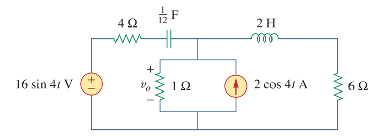
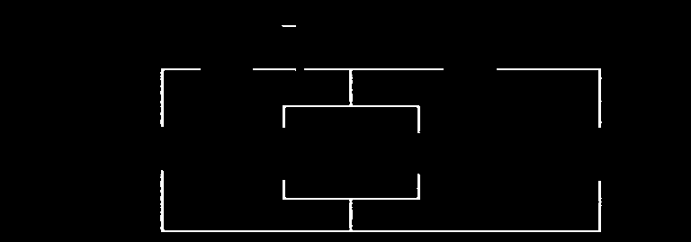

> **DO NOT DISTRIBUTE: INTELLECTUAL PROPERTY OF HKU ECE**

<h1 align="center">K-Bot</h1>

Upload a circuit. Ask a question. See the working.

<a href="run.md">Setup guide</a> · <a href="#pipeline">Pipeline</a> · <a href="https://huggingface.co/Meghamsh111/KBOT-models">Models</a>

K-Bot reads circuit diagrams and produces worked answers. The web interface shows each stage, from finding components and tracing wires to calculating and explaining the result.

## How it works

The images below are actual outputs from a saved run on Sadiku Figure 10.52.

<table>
<tr><th width="50%">Circuit image</th><th width="50%">Component detections</th></tr>
<tr><td></td><td></td></tr>
</table>

### Find the components

**YOLO26n** identifies components and marks their positions with bounding boxes.

### Trace the wires

**SAM2.1** helps isolate the diagram's lines. Processing then removes component bodies to produce the wire mask below.

White lines show the retained wires. Gaps where components were removed are expected.

### Connect the components

The **graph assembler** works out which component terminals are connected and builds the circuit used for calculation.

### Read, calculate and explain

The **vision-language model** reads values and labels and interprets the question. **SymPy** calculates the answer, **ngspice** checks the calculation, and the explanation model presents the working.

## Run K-Bot

Follow **[run.md](run.md)** to install the software, download the models, sign in and start the web interface. Each teammate needs their own hosted-model login and access.

The models are stored on [Hugging Face](https://huggingface.co/Meghamsh111/KBOT-models). See [run.md](run.md#what-is-included) for files kept outside GitHub. Docker remains experimental and unverified.

## Current status

A fresh environment on the original Mac completed one known AC circuit through the browser in **55.8 seconds**. The answer matched an independent calculation. See the [reproduction record](provenance/HANDOFF_REPRODUCTION_20261119.json).

Faint wires, crossings and misread labels can still produce the wrong circuit. One successful example does not establish accuracy on new circuits. A second physical machine has not been tested.

## Access and ownership

This is a private research project. Project-owned material must not be distributed without authorization. Third-party software, models and diagrams retain their own terms. See [LICENSE](LICENSE) for the ownership notice and legal references.
