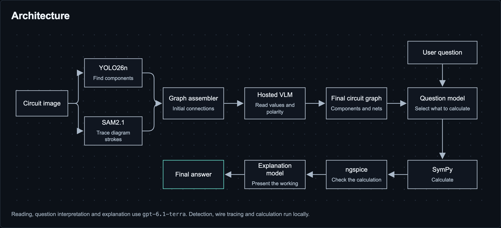
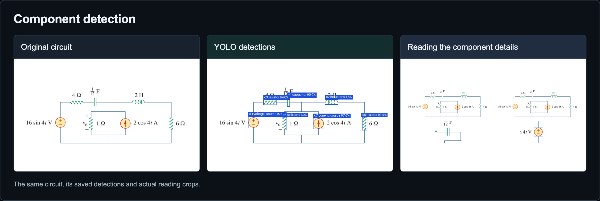
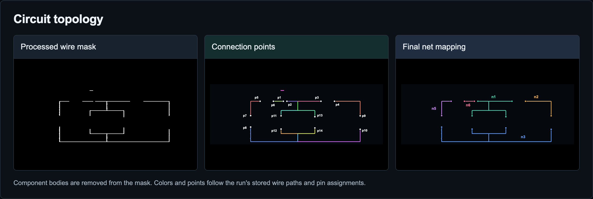
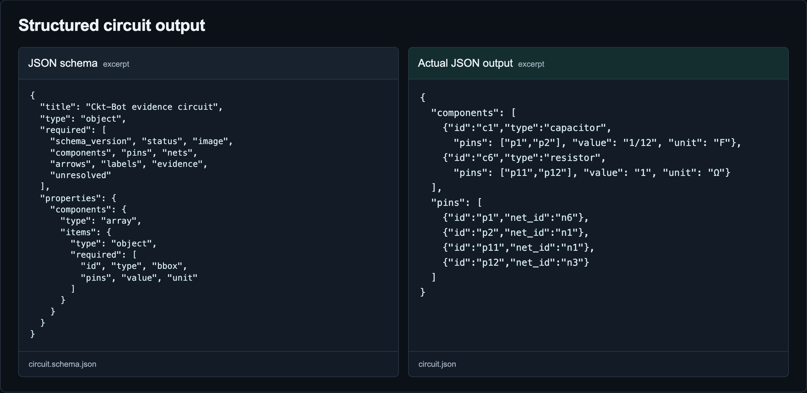
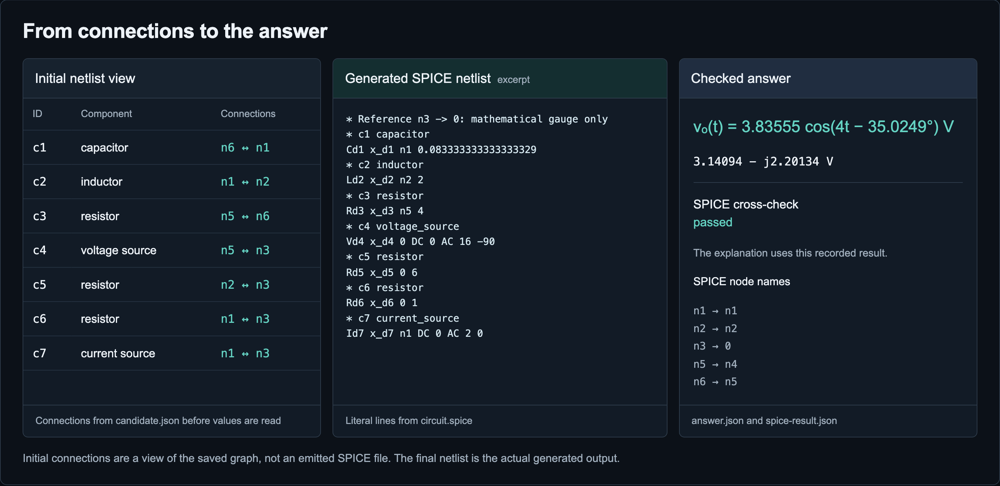

**禁止散佈：HKU ECE 知識產權**

**禁止複製、洩露、重新上載或出售。涉及本項目自有材料，須取得書面授權，但受下述權利及例外情況所限。**

**版權 2026。本項目自有材料的一切權利由其合法權利持有人保留。**

**機密材料。僅供獲授權的內部研究及審閱使用。本聲明不授予任何公眾授權，以使用、複製、修改、披露、散佈、發佈、再授權或商業化本項目自有材料。須事先取得相關權利持有人的書面許可。**

**未經授權複製、披露或散佈本項目自有材料，可能招致法律行動，包括民事訴訟、禁制令、損害賠償及法律費用。**

**更改項目名稱、移除此聲明，或在網上找到副本，均不代表獲得許可。除適用授權或法律另有准許外，複製或分享本項目自有材料前，須先取得書面授權。**

**HKU ECE 的署名是項目擁有人指定的聲明。所有權及授權權限仍受適用法律、香港大學知識產權政策及相關協議規限。本聲明本身不構成權利轉讓。**

**第三方元件、授權及聲明仍受其原有條款規限。本聲明不主張擁有該等元件，亦不限制其授權所賦予的權利。法定例外及不可放棄的權利不受影響。**

**民事權利救濟：[香港《版權條例》（第 528 章）第 107 至 108 條](https://www.elegislation.gov.hk/hk/cap528)。**

**國際版權框架：[《伯爾尼公約》第 2 及 5 條](https://www.wipo.int/wipolex/en/text/283698) · [《與貿易有關的知識產權協定》第 9 至 10 及 41 至 45 條](https://www.wto.org/english/docs_e/legal_e/trips_e.htm) · [《世界知識產權組織版權條約》第 4、8 及 14 條](https://www.wipo.int/wipolex/en/text/295166)。權利救濟須按適用的本地法律進行。**

**[完整授權條款](LICENSE) · [版權指引](https://www.ipd.gov.hk/en/copyright/what-is-copyright/index.html) · [香港大學知識產權政策](https://www.rss.hku.hk/contracts/ipr)**

---

<h1 align="center">K-Bot</h1>

<a href="README.md">English</a> · <strong>廣東話（繁體）</strong> · <a href="README.zh-CN.md">普通话（简体）</a>

上載電路圖，問條問題，睇清楚計算過程。

<a href="run.md">安裝指南</a> · <a href="#pipeline">處理流程</a> · <a href="https://huggingface.co/Meghamsh111/KBOT-models">模型</a>

K-Bot 讀取電路圖，並提供有計算步驟嘅答案。網頁介面會逐個階段展示，由搵出元件、追蹤導線，到計算同解釋結果。

## 架構

## 運作流程

以下圖板用嘅都係已完成嘅 Sadiku 圖 10.52 執行結果。呢個係已知例子。

### 搵出元件

**YOLO26n** 識別元件，並用邊界框標示佢哋嘅位置。

### 追蹤導線，連接元件

**SAM2.1** 提供線條遮罩。**連接分析程式** 會追蹤元件端子之間嘅連接。

### 讀取、計算同解釋

**視覺語言模型** 讀取數值同標籤。理解問題嘅模型會揀出要計嘅量。**SymPy** 計出答案，**ngspice** 核對結果，再由解釋模型展示計算步驟。

以上圖板用儲低嘅執行數據，透過 [HTML 同 CSS](docs/visuals/index.html) 渲染而成。原始碼同渲染腳本都放喺同一個資料夾。

## 執行 K-Bot

跟住 **[run.md](run.md)** 安裝軟件、下載模型、登入同啟動網頁介面。每位團隊成員都需要用自己嘅雲端模型帳戶登入，並有相應存取權限。

模型存放喺 [Hugging Face](https://huggingface.co/Meghamsh111/KBOT-models)。邊啲檔案冇放入 GitHub，可以睇 [run.md](run.md#what-is-included)。Docker 仍然係實驗性方案，未經驗證。

## 目前狀態

喺原本嗰部 Mac 嘅全新環境，透過瀏覽器完整跑咗一個已知 AC 電路，用時 **55.8 秒**。答案同獨立計算結果一致。詳情可以睇[重現記錄](provenance/HANDOFF_REPRODUCTION_20261119.json)。

模糊導線、交叉位同讀錯標籤，仍然可能令系統重建出錯誤電路。一個成功例子唔足以證明系統處理新電路嘅準確度。另一部實體電腦仍未測試。
