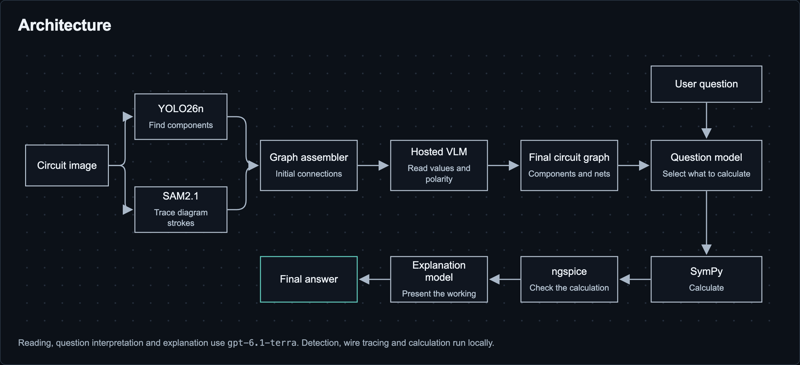
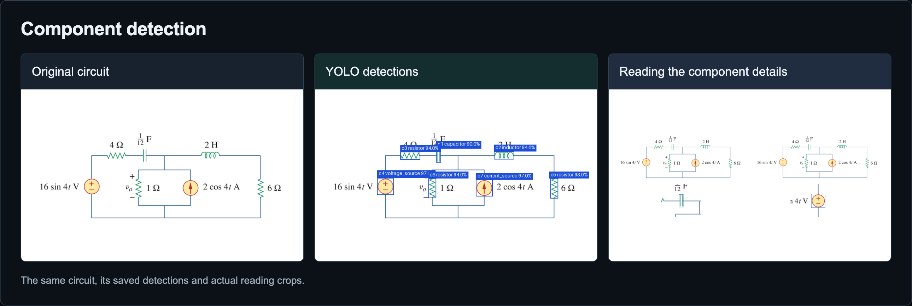
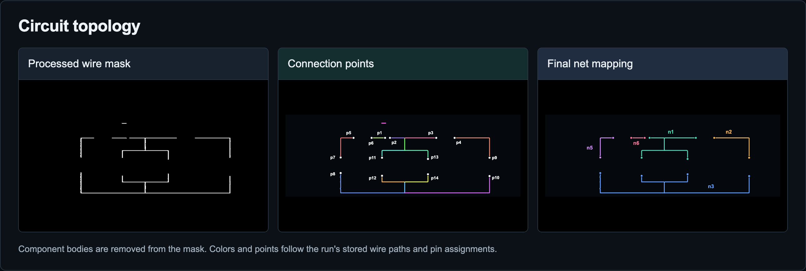
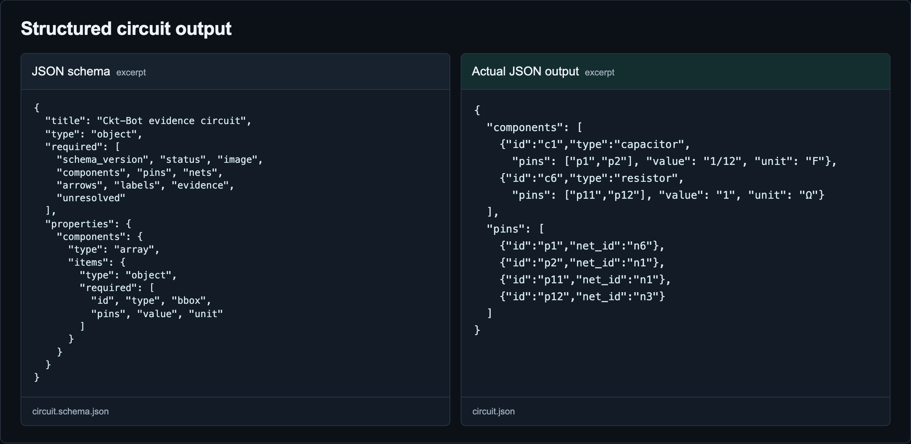
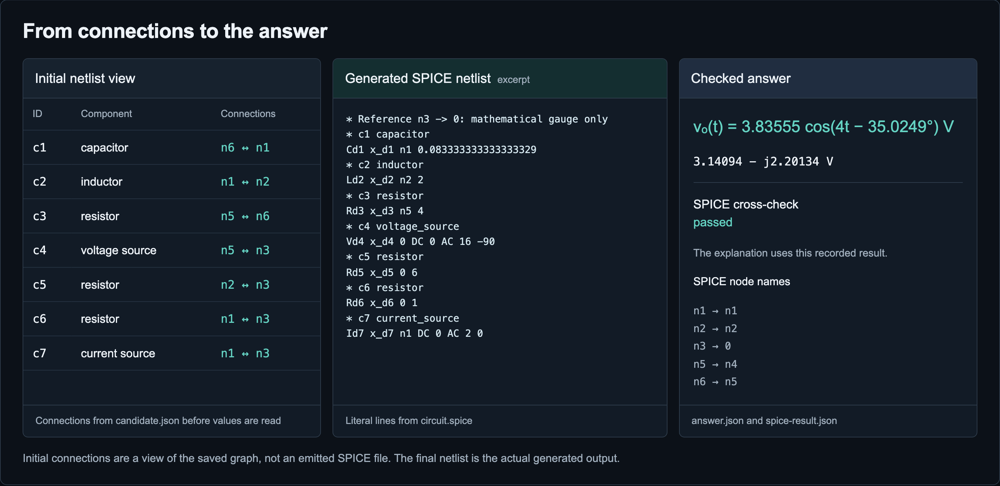

**禁止分发：HKU ECE 知识产权**

**禁止擅自复制、泄露、重新上传或出售。使用本项目拥有权利的材料须获得书面授权，并受下述权利和例外规定约束。**

**版权 2026。本项目材料的合法权利人保留其享有的全部权利。**

**本仓库包含保密材料，仅供获授权的内部研究和审阅使用。未向公众授予使用、复制、修改、披露、分发、发布、再许可或商业化本项目拥有权利的材料的许可。上述行为须事先取得相关权利人的书面同意。**

**未经授权复制、披露或分发本项目拥有权利的材料，可能导致法律行动，包括民事诉讼、禁令、损害赔偿及诉讼费用。**

**更改项目名称、删除本声明，或在网上找到本项目的副本，并不代表获得使用许可。复制或分享本项目拥有权利的材料前，须取得书面授权，但适用许可或法律允许的情况除外。**

**HKU ECE 是项目所有者指定的归属标示。实际权利归属及授权权限仍须依照适用法律、香港大学知识产权政策及相关协议确定。本声明不构成权利转让。**

**第三方组件、许可及声明继续受其原有条款约束。本声明不主张拥有这些组件的权利，也不限制其许可已授予的权利。法定例外及不可放弃的权利不受影响。**

**民事权利救济：[香港《版权条例》（第 528 章），第 107 至 108 条](https://www.elegislation.gov.hk/hk/cap528)。**

**国际版权框架：[《伯尔尼公约》第 2、5 条](https://www.wipo.int/wipolex/en/text/283698) · [《与贸易有关的知识产权协定》（TRIPS）第 9 至 10、41 至 45 条](https://www.wto.org/english/docs_e/legal_e/trips_e.htm) · [《世界知识产权组织版权条约》第 4、8、14 条](https://www.wipo.int/wipolex/en/text/295166)。权利救济须依照适用的本地法律进行。**

**[完整许可条款](LICENSE) · [版权指引](https://www.ipd.gov.hk/en/copyright/what-is-copyright/index.html) · [香港大学知识产权政策](https://www.rss.hku.hk/contracts/ipr)**

---

<h1 align="center">Ckt-Bot</h1>

<strong>English</strong>

**DO NOT DISTRIBUTE: INTELLECTUAL PROPERTY OF HKU ECE**

**DO NOT COPY. DO NOT LEAK. DO NOT REUPLOAD. DO NOT SELL. WRITTEN AUTHORIZATION IS REQUIRED FOR PROJECT-OWNED MATERIAL, SUBJECT TO THE RIGHTS AND EXCEPTIONS BELOW.**

**COPYRIGHT 2026. ALL RIGHTS RESERVED IN PROJECT-OWNED MATERIAL BY ITS LAWFUL RIGHTS HOLDERS.**

**CONFIDENTIAL MATERIAL. AUTHORIZED INTERNAL RESEARCH AND REVIEW ONLY. NO PUBLIC LICENSE IS GRANTED TO USE, COPY, MODIFY, DISCLOSE, DISTRIBUTE, PUBLISH, SUBLICENSE OR COMMERCIALIZE PROJECT-OWNED MATERIAL. PRIOR WRITTEN PERMISSION FROM THE RELEVANT RIGHTS HOLDER IS REQUIRED.**

**UNAUTHORIZED COPYING, DISCLOSURE OR DISTRIBUTION OF PROJECT-OWNED MATERIAL MAY RESULT IN LEGAL ACTION, INCLUDING CIVIL LAWSUITS, INJUNCTIONS, DAMAGES AND LEGAL COSTS.**

**RENAMING THE PROJECT, REMOVING THIS NOTICE OR FINDING A COPY ONLINE DOES NOT GIVE YOU PERMISSION. GET WRITTEN AUTHORIZATION BEFORE COPYING OR SHARING PROJECT-OWNED MATERIAL, EXCEPT WHERE AN APPLICABLE LICENSE OR THE LAW PERMITS IT.**

**THE HKU ECE ATTRIBUTION IS THE PROJECT OWNER'S DESIGNATED NOTICE. OWNERSHIP AND AUTHORITY REMAIN SUBJECT TO APPLICABLE LAW, HKU INTELLECTUAL PROPERTY POLICY AND RELEVANT AGREEMENTS. THIS NOTICE DOES NOT EXECUTE AN ASSIGNMENT OF RIGHTS.**

**THIRD-PARTY COMPONENTS, LICENSES AND NOTICES REMAIN SUBJECT TO THEIR ORIGINAL TERMS. THIS NOTICE DOES NOT CLAIM OWNERSHIP OF THOSE COMPONENTS OR RESTRICT RIGHTS GRANTED UNDER THEIR LICENSES. STATUTORY EXCEPTIONS AND NON-WAIVABLE RIGHTS REMAIN UNAFFECTED.**

**CIVIL ENFORCEMENT: [HONG KONG COPYRIGHT ORDINANCE, CAP. 528, SECTIONS 107-108](https://www.elegislation.gov.hk/hk/cap528).**

**INTERNATIONAL COPYRIGHT FRAMEWORK: [BERNE CONVENTION, ARTICLES 2 AND 5](https://www.wipo.int/wipolex/en/text/283698) · [TRIPS AGREEMENT, ARTICLES 9-10 AND 41-45](https://www.wto.org/english/docs_e/legal_e/trips_e.htm) · [WIPO COPYRIGHT TREATY, ARTICLES 4, 8 AND 14](https://www.wipo.int/wipolex/en/text/295166). ENFORCEMENT IS SUBJECT TO APPLICABLE NATIONAL LAW.**

**[FULL LICENSE](LICENSE) · [COPYRIGHT GUIDANCE](https://www.ipd.gov.hk/en/copyright/what-is-copyright/index.html) · [HKU INTELLECTUAL PROPERTY POLICY](https://www.rss.hku.hk/contracts/ipr)**

---

Upload a circuit. Ask a question. See the working.

<a href="run.md">Setup guide</a> · <a href="#pipeline-en">Pipeline</a> · <a href="https://huggingface.co/Meghamsh111/Ckt-Bot-models">Models</a>

Ckt-Bot reads circuit diagrams and produces worked answers. The web interface shows each stage, from finding components and tracing wires to calculating and explaining the result.

## Architecture

## How it works

The panels use actual outputs from the completed Sadiku Figure 10.52 run, a known example.

### Find the components

**YOLO26n** identifies components and marks their positions with bounding boxes.

### Trace wires and connect components

**SAM2.1** supplies the line mask. The **graph assembler** traces connections between component terminals.

### Read, calculate and explain

The **vision-language model** reads values and labels. The question model selects what to calculate. **SymPy** calculates the answer, **ngspice** checks it, and the explanation model presents the working.

The panels are rendered from [HTML and CSS](docs/visuals/index.html), using the saved run data. Their source and rendering script are included in the same folder.

## Run Ckt-Bot

Follow **[run.md](run.md)** to install the software, download the models, sign in and start the web interface. Each teammate needs their own hosted-model login and access.

The models are stored on [Hugging Face](https://huggingface.co/Meghamsh111/Ckt-Bot-models). Training data is kept separately in a private [data archive](https://huggingface.co/datasets/Meghamsh111/Ckt-Bot-data) and is not needed or downloaded for normal setup. See [run.md](run.md#what-is-included) for files kept outside GitHub. Docker remains experimental and unverified.

## Current status

A fresh environment on the original Mac completed one known AC circuit through the browser in **55.8 seconds**. The answer matched an independent calculation. See the [reproduction record](provenance/HANDOFF_REPRODUCTION_20261119.json).

Faint wires, crossings and misread labels can still produce the wrong circuit. One successful example does not establish accuracy on new circuits. A second physical machine has not been tested.

<strong>廣東話（繁體）</strong>

**禁止散佈：HKU ECE 知識產權**

**禁止複製、洩露、重新上載或出售。涉及本項目自有材料，須取得書面授權，但受下述權利及例外情況所限。**

**版權 2026。本項目自有材料的一切權利由其合法權利持有人保留。**

**機密材料。僅供獲授權的內部研究及審閱使用。本聲明不授予任何公眾授權，以使用、複製、修改、披露、散佈、發佈、再授權或商業化本項目自有材料。須事先取得相關權利持有人的書面許可。**

**未經授權複製、披露或散佈本項目自有材料，可能招致法律行動，包括民事訴訟、禁制令、損害賠償及法律費用。**

**更改項目名稱、移除此聲明，或在網上找到副本，均不代表獲得許可。除適用授權或法律另有准許外，複製或分享本項目自有材料前，須先取得書面授權。**

**HKU ECE 的署名是項目擁有人指定的聲明。所有權及授權權限仍受適用法律、香港大學知識產權政策及相關協議規限。本聲明本身不構成權利轉讓。**

**第三方元件、授權及聲明仍受其原有條款規限。本聲明不主張擁有該等元件，亦不限制其授權所賦予的權利。法定例外及不可放棄的權利不受影響。**

**民事權利救濟：[香港《版權條例》（第 528 章）第 107 至 108 條](https://www.elegislation.gov.hk/hk/cap528)。**

**國際版權框架：[《伯爾尼公約》第 2 及 5 條](https://www.wipo.int/wipolex/en/text/283698) · [《與貿易有關的知識產權協定》第 9 至 10 及 41 至 45 條](https://www.wto.org/english/docs_e/legal_e/trips_e.htm) · [《世界知識產權組織版權條約》第 4、8 及 14 條](https://www.wipo.int/wipolex/en/text/295166)。權利救濟須按適用的本地法律進行。**

**[完整授權條款](LICENSE) · [版權指引](https://www.ipd.gov.hk/en/copyright/what-is-copyright/index.html) · [香港大學知識產權政策](https://www.rss.hku.hk/contracts/ipr)**

---

上載電路圖，問條問題，睇清楚計算過程。

<a href="run.md">安裝指南</a> · <a href="#pipeline-yue">處理流程</a> · <a href="https://huggingface.co/Meghamsh111/Ckt-Bot-models">模型</a>

Ckt-Bot 讀取電路圖，並提供有計算步驟嘅答案。網頁介面會逐個階段展示，由搵出元件、追蹤導線，到計算同解釋結果。

## 架構

## 運作流程

以下圖板用嘅都係已完成嘅 Sadiku 圖 10.52 執行結果。呢個係已知例子。

### 搵出元件

**YOLO26n** 識別元件，並用邊界框標示佢哋嘅位置。

### 追蹤導線，連接元件

**SAM2.1** 提供線條遮罩。**連接分析程式** 會追蹤元件端子之間嘅連接。

### 讀取、計算同解釋

**視覺語言模型** 讀取數值同標籤。理解問題嘅模型會揀出要計嘅量。**SymPy** 計出答案，**ngspice** 核對結果，再由解釋模型展示計算步驟。

以上圖板用儲低嘅執行數據，透過 [HTML 同 CSS](docs/visuals/index.html) 渲染而成。原始碼同渲染腳本都放喺同一個資料夾。

## 執行 Ckt-Bot

跟住 **[run.md](run.md)** 安裝軟件、下載模型、登入同啟動網頁介面。每位團隊成員都需要用自己嘅雲端模型帳戶登入，並有相應存取權限。

模型存放喺 [Hugging Face](https://huggingface.co/Meghamsh111/Ckt-Bot-models)。訓練數據另外存放喺私人[數據庫](https://huggingface.co/datasets/Meghamsh111/Ckt-Bot-data)；一般安裝同執行唔需要亦唔會下載訓練數據。邊啲檔案冇放入 GitHub，可以睇 [run.md](run.md#what-is-included)。Docker 仍然係實驗性方案，未經驗證。

## 目前狀態

喺原本嗰部 Mac 嘅全新環境，透過瀏覽器完整跑咗一個已知 AC 電路，用時 **55.8 秒**。答案同獨立計算結果一致。詳情可以睇[重現記錄](provenance/HANDOFF_REPRODUCTION_20261119.json)。

模糊導線、交叉位同讀錯標籤，仍然可能令系統重建出錯誤電路。一個成功例子唔足以證明系統處理新電路嘅準確度。另一部實體電腦仍未測試。

<strong>普通话（简体）</strong>

上传电路图，输入问题，查看解题过程。

<a href="run.md">安装指南</a> · <a href="#pipeline-zh">处理流程</a> · <a href="https://huggingface.co/Meghamsh111/Ckt-Bot-models">模型</a>

Ckt-Bot 读取电路图并给出带有解题步骤的答案。网页会展示各个处理阶段，包括识别元件、追踪导线、分析连接、计算及解释结果。

## 架构

## 工作流程

以下图片使用已完成的 Sadiku 图 10.52 运行结果。这是一个已知示例。

### 识别元件

**YOLO26n** 识别元件，并用边界框标出其位置。

### 追踪导线并连接元件

**SAM2.1** 提供线条掩膜。**连接分析程序**追踪元件引脚之间的连接。

### 读取、计算并说明

**视觉语言模型**读取数值和标签。问题理解模型确定需要计算的量。**SymPy** 计算答案，**ngspice** 核对计算结果，解释模型给出解题步骤。

这些图片使用保存的运行数据，通过 [HTML 和 CSS](docs/visuals/index.html) 渲染生成。源代码及渲染脚本位于同一文件夹。

## 运行 Ckt-Bot

按照 **[run.md](run.md)** 安装软件、下载模型、登录并启动网页。每位团队成员都需要自己的托管模型登录账号及访问权限。

模型存放在 [Hugging Face](https://huggingface.co/Meghamsh111/Ckt-Bot-models)。训练数据单独存放在私有[数据仓库](https://huggingface.co/datasets/Meghamsh111/Ckt-Bot-data)；正常安装和运行不需要，也不会下载训练数据。未包含在 GitHub 仓库中的文件见 [run.md](run.md#what-is-included)。Docker 仍处于实验阶段，尚未验证。

## 当前状态

在原有 Mac 的一个新环境中，通过浏览器完成一个已知交流电路的处理，用时 **55.8 秒**。答案与独立计算一致。详见[复现记录](provenance/HANDOFF_REPRODUCTION_20261119.json)。

模糊的导线、交叉点及错误读取的标签仍可能导致电路识别错误。一个示例成功并不能证明对新电路的准确率。目前尚未在第二台实体电脑上测试。

